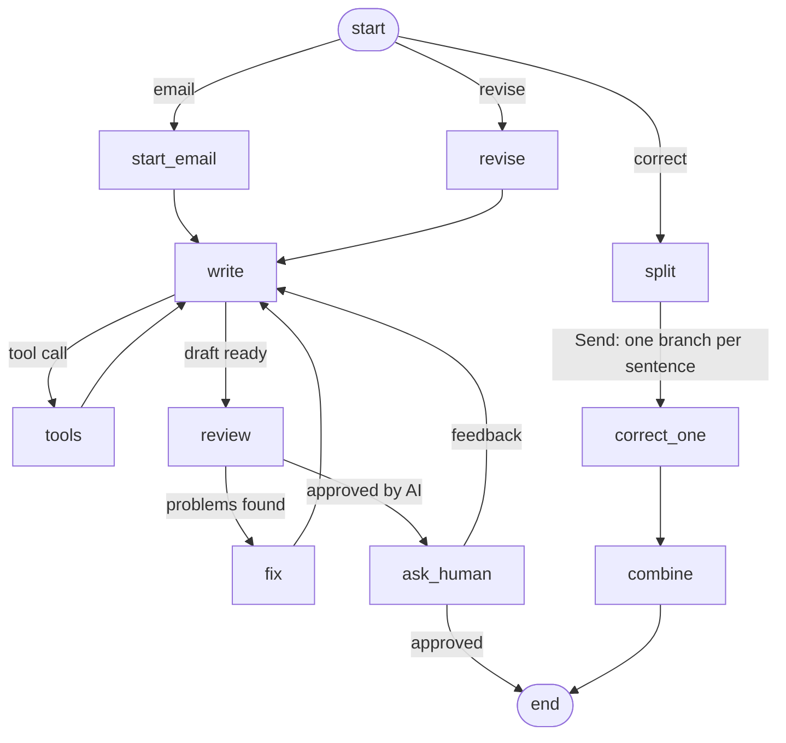

# LangGraph Writing Assistant

**A private, offline AI writing assistant built as a LangGraph workflow: it drafts, reviews and fixes its own work, pauses for human approval, corrects sentences in parallel and caches results, all on a local model.**

[](https://github.com/rizwannazir333/langgraph-writing-assistant/actions/workflows/ci.yml)


-6E40C9)


> **Series: Building the same AI app three ways**
> [Part 1: Plain Ollama](https://github.com/rizwannazir333/ollama-writing-assistant) · [Part 2: LangChain](https://github.com/rizwannazir333/langchain-writing-assistant) · **Part 3: LangGraph** (this repo)

---

## Overview

Parts [1](https://github.com/rizwannazir333/ollama-writing-assistant) and [2](https://github.com/rizwannazir333/langchain-writing-assistant)
of this series run in a straight line: input → model → output. Real-world AI applications need more than
that. They must **check their own work**, **retry when something is wrong**, **wait for a person to approve**,
and **split large jobs into smaller parallel ones**.

In this final part, I rebuild the same email and grammar assistant as a **LangGraph state machine**.
The program is expressed as a graph of small Python functions (nodes) connected by edges, sharing a
single state. This repository demonstrates **thirteen LangGraph features** in one readable file:

- **Email workflow:** draft → look up real dates with tools → AI self-review → automatic fix →
  **human approval** → done, or rewrite with your feedback.
- **Conversational revision:** continue the same saved thread to revise the last email.
- **Parallel correction:** every sentence is corrected in its own branch, then merged.
- **Caching:** repeated work is returned instantly with no model call.
- **A hand-built agent:** see exactly how a tool-calling agent loop works inside.

Everything runs locally on a 4-bit quantized model. **No API key, no cloud, no data leaves your machine.**

---

## Workflow Graph



> Generate this diagram from the live code with `python langgraph_writing_assistant.py --show-graph`.

---

## LangGraph Features Demonstrated

Each feature is marked with a `FEATURE` comment in [`langgraph_writing_assistant.py`](langgraph_writing_assistant.py).

| # | Feature | LangGraph API | Role in this project |
|---|---|---|---|
| 1 | Typed state | `TypedDict` + reducers | Shared state with `add_messages` / `operator.add` merging |
| 2 | Nodes & edges | `StateGraph.add_node / add_edge` | Each step is a plain Python function |
| 3 | Conditional routing | `add_conditional_edges` | Route by task; decide fix vs. approve |
| 4 | Cycles | edge back to `write` | Self-review loop: write → review → fix → write |
| 5 | Tools | `ToolNode` + `tools_condition` | Resolve *"next Friday"* to a real date |
| 6 | Human-in-the-loop | `interrupt()` | Pause for approval or feedback |
| 7 | Persistence | `InMemorySaver` + `thread_id` | Pause/resume and conversational revision |
| 8 | Map-reduce | `Send` | Correct sentences in parallel branches |
| 9 | Fault tolerance | `RetryPolicy` | Automatically retry failed model steps |
| 10 | Streaming | `stream_mode="updates"` | Progress reported as each step completes |
| 11 | Custom agent | `MessagesState` + `ToolNode` | A tool-calling agent built from scratch |
| 12 | Node caching | `CachePolicy` + `InMemoryCache` | Identical requests return instantly |
| 13 | Time travel | `get_state_history` | Inspect every saved checkpoint of a run |

---

## Getting Started

### Prerequisites

- Python **3.10+**
- [Ollama](https://ollama.com/download) installed and running
- **8 GB RAM** minimum (16 GB recommended); **no GPU required**

### Installation

```bash
# 1. Download the model (one time, ~3.3 GB)
ollama pull qwen3.5:4b

# 2. Clone the repository
git clone https://github.com/rizwannazir333/langgraph-writing-assistant.git
cd langgraph-writing-assistant

# 3. Create a virtual environment and install dependencies
python -m venv .venv
# Windows
.venv\Scripts\python -m pip install -r requirements.txt
# macOS / Linux
.venv/bin/python -m pip install -r requirements.txt
```

> The script detects a `.venv` folder next to it and re-launches itself with that interpreter, so
> `python langgraph_writing_assistant.py` works without activating the environment.

---

## Usage

### Interactive menu

```bash
python langgraph_writing_assistant.py
```

```
[langgraph | model: qwen3.5:4b | thinking: off]

1) Draft email          2) Revise last email
3) Correct English      4) Correct many lines
5) Email agent (finds real dates)
h) Show saved steps of the last run      q) Quit
```

### Example: email with self-review and human approval

```
> 1
What should the email say?
> ask my manager for Friday off for a family event
Tone (Enter = professional):
[step done: start_email]
[step done: write]
[step done: review]

===== DRAFT =====
Subject: Request for Time Off - Family Event

Dear [Manager],

I am writing to request time off on Friday, 13 November 2026, to attend a family event. ...

Press Enter to approve, or type a change:
>
[step done: ask_human]

===== RESULT =====
...
```

When the reviewer finds a problem, you'll see the loop in action:

```
[step done: review -> problems: Missing date of the new delivery date]
[step done: fix]
[step done: write]
```

### Example: parallel correction

```
> 3
Text to correct:
> he go to school yesterday. me and him is late
[step done: split]
[step done: correct_one]
[step done: correct_one]
[step done: combine]

===== RESULT =====
Corrected: He went to school yesterday. He and I are late.
Changes:
- go -> went (Changed verb to past tense to match 'yesterday'.)
- me -> I (Subject pronoun required)
- him -> He (Subject pronoun required)
- is -> are (Verb must agree with plural subject 'He and I')
```

### Example: caching

Correcting the same text a second time skips the model entirely:

```
[step done: split]
[step done: correct_one]
[cache: saved answer reused, no model call]
[step done: combine]
(0s)
```

### One-line commands

```bash
python langgraph_writing_assistant.py email "ask my manager for next Friday off"
python langgraph_writing_assistant.py --tone friendly email "invite the team to lunch"
python langgraph_writing_assistant.py correct "he go to school. me and him is late"
python langgraph_writing_assistant.py agent "ask my manager for next Friday off"
python langgraph_writing_assistant.py --yes email "..."          # auto-approve
python langgraph_writing_assistant.py --think email "..."        # show reasoning
python langgraph_writing_assistant.py --show-graph               # print Mermaid diagram
```

### Options

| Option | Description |
|---|---|
| `email` / `correct` / `agent` `TEXT` | Run one task and exit |
| `--tone TONE` | Email tone (default `professional`) |
| `--yes` | Skip the human approval pause |
| `--think` | Stream the model's reasoning live (more accurate, much slower on CPU) |
| `-m MODEL` | Use a specific Ollama model |
| `--show-graph` | Print the workflow as a Mermaid diagram |

Model selection: first installed of `qwen3.5:4b` → `llama3.2:3b` → `qwen2.5:3b` → `qwen3.5:latest`.

---

## Code Walkthrough

### State with reducers

```python
class State(TypedDict, total=False):
    task: str
    text: str
    tone: str
    messages: Annotated[list, add_messages]     # appended, not replaced
    draft: str
    problems: str
    fixes: int
    sentences: list[str]
    corrected: Annotated[list, operator.add]    # merged from parallel branches
    result: str
```

### Wiring the graph

```python
g.add_conditional_edges(START, pick_task, ["start_email", "revise", "split"])
g.add_edge("start_email", "write")
g.add_edge("revise", "write")
g.add_conditional_edges("write", tools_condition, {"tools": "tools", END: "review"})
g.add_edge("tools", "write")
g.add_conditional_edges("review", fix_or_ask, ["fix", "ask_human"])
g.add_edge("fix", "write")
g.add_conditional_edges("ask_human", done_or_rewrite, ["write", END])
g.add_conditional_edges("split", one_branch_per_sentence, ["correct_one"])
g.add_edge("correct_one", "combine")
g.add_edge("combine", END)

graph = g.compile(checkpointer=InMemorySaver(), cache=InMemoryCache())
```

### Human-in-the-loop

```python
def ask_human(state):
    answer = interrupt(state["draft"])          # execution pauses; state is checkpointed
    if not answer.strip():
        return {"result": state["draft"]}       # approved
    return {"messages": [HumanMessage(f"Rewrite the email with this change: {answer}")]}
```

The runner resumes the paused thread with `graph.stream(Command(resume=answer), config)`.

### Map-reduce with `Send`

```python
def one_branch_per_sentence(state):
    return [Send("correct_one", {"i": i, "sentence": s})
            for i, s in enumerate(state["sentences"])]
```

### A tool-calling agent, built by hand

```python
g = StateGraph(MessagesState)
g.add_node("agent", agent)                          # model with tools bound
g.add_node("tools", ToolNode(TOOLS))
g.add_edge(START, "agent")
g.add_conditional_edges("agent", tools_condition)   # tool call → tools, else → END
g.add_edge("tools", "agent")
```

---

## Performance

Measured on an **Intel Core i7-1165G7, 16 GB RAM, no GPU**, Windows 11, model `qwen3.5:4b`, thinking off:

| Operation | Time |
|---|---|
| Draft email (write + review + approval) | **30–65 s** |
| Revise last email | **~35 s** |
| Correct text (per run) | **25–45 s** |
| Correct the same text again (cached) | **0 s** |
| Correct many lines (2 lines) | **~25 s** |
| Agent email | **~15 s** |

---

## Design Decisions

- **Small, single-purpose nodes:** each step does one thing, which makes the workflow easy to read,
  test and rearrange.
- **Bounded self-review:** `MAX_FIXES = 1` gives the reviewer one chance to send a draft back,
  balancing quality against CPU time.
- **Human approval before completion:** an AI-written email should never be final without a person
  seeing it; `interrupt()` makes that a first-class step rather than an afterthought.
- **Graceful degradation:** if a small model returns malformed JSON, the review is skipped and the
  original sentence is kept, instead of crashing the workflow.
- **Caching only where it is safe:** sentence correction is deterministic enough to cache; email
  writing depends on conversation history and is not cached.

---

## Limitations

- The AI reviewer is a small model too; it does not catch every issue. The human approval step is the
  real safeguard. **Always read an email before sending it.**
- `InMemorySaver` and `InMemoryCache` are cleared when the program exits.
- Parallel branches run one at a time on a single local model (`max_concurrency=1`), so the parallelism
  is structural rather than a speed-up on CPU.

---

## Extend It

1. Set `MAX_FIXES = 2` and compare quality and runtime.
2. Add a `translate` node after approval that translates the final email.
3. Add a `tone_check` node that runs **in parallel** with `review`.
4. Route sentences that need no changes around the model with a conditional edge.
5. Replace `InMemorySaver` with `SqliteSaver` (`pip install langgraph-checkpoint-sqlite`) so threads
   survive restarts.

---

## Troubleshooting

| Problem | Solution |
|---|---|
| `model "qwen3.5:4b" not found` | Run `ollama pull qwen3.5:4b` |
| `Connection refused` | Start the Ollama app, or run `ollama serve` |
| `ModuleNotFoundError: No module named 'langgraph'` | Complete the installation step |
| The program stops at `===== DRAFT =====` | That's the approval pause: press **Enter** to approve, or type a change |
| Very slow responses | Avoid `--think`, run one model at a time (`ollama ps`) |

---

## Project Structure

```
langgraph-writing-assistant/
├── langgraph_writing_assistant.py  # the application
├── requirements.txt            # pinned dependencies
├── .gitignore                  # keeps .venv and caches out of Git
├── LICENSE                     # MIT License
└── README.md                   # this document
```

---

## The Full Series

| | [Plain Ollama](https://github.com/rizwannazir333/ollama-writing-assistant) | [LangChain](https://github.com/rizwannazir333/langchain-writing-assistant) | **LangGraph** |
|---|---|---|---|
| Best for | Learning, small scripts | Linear pipelines | Workflows with decisions, loops, approvals |
| Memory | Manual | Message history | Built-in checkpointer |
| Tools / agents | Manual | `create_agent` | `ToolNode` + custom graph |
| Human approval | — | — | ✓ `interrupt()` |
| Self-review loops | — | Difficult | ✓ Native cycles |
| Parallel steps | — | `.batch()` | ✓ `Send` |
| Caching | — | Possible | ✓ `CachePolicy` |

**Rule of thumb:** start with the simplest tool that solves the problem. Reach for LangChain when you
need reusable prompts and structured output, and for LangGraph when your application must **decide,
loop or wait for a human**.

---

## License

Released under the [MIT License](LICENSE). You are free to use, modify and share this
project, including in your own courses and classrooms, as long as the copyright notice is kept.

---

## Author

Created and maintained by **[@rizwannazir333](https://github.com/rizwannazir333)**.

If this project helped you learn, please consider giving it a ⭐. Questions, suggestions and
improvements are welcome through [Issues](https://github.com/rizwannazir333/langgraph-writing-assistant/issues).
