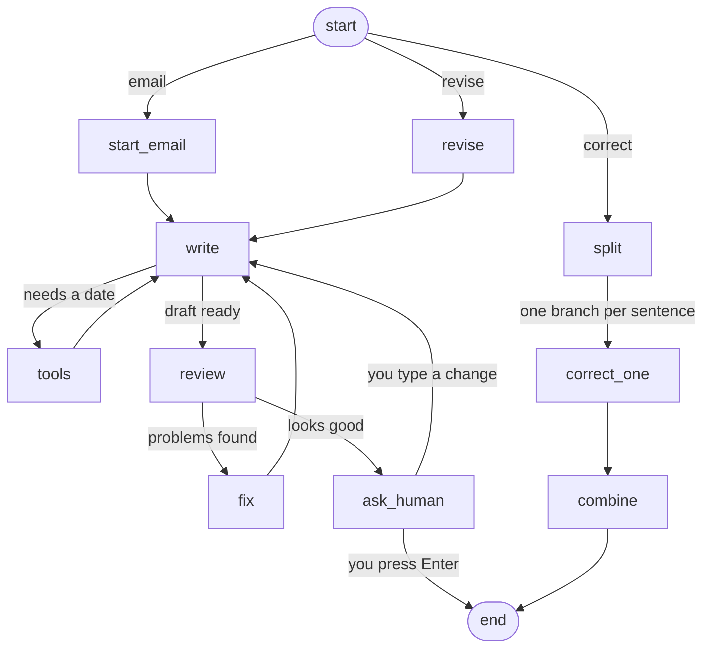

# Part 3: Local AI Writing Assistant with LangGraph

> **Series:** [Part 1: Ollama](https://github.com/rizwannazir333/ollama-email-english) · [Part 2: LangChain](https://github.com/rizwannazir333/langchain-email-english) · **Part 3: LangGraph**

Build an **email writer** and an **English grammar checker** that run **100% on your own computer**.
No API key, no internet, no cost.

In Parts 1 and 2 our programs ran in a **straight line**. Real work is not like that: we **check**
our work, **fix** mistakes, **ask someone** before sending, and **split** big jobs into small ones.
**LangGraph** lets you draw your program as a **graph** that can do all of this.

- **Nodes** = steps (plain Python functions)
- **Edges** = arrows between steps
- **State** = a shared dictionary that every step can read and update

---

## The graph of this project



**In words:**
- **Email:** write → (look up a date if needed) → an AI **reviewer** checks the draft →
  fix it once if needed → **pause and ask you** → done, or rewrite with your change.
- **Correct:** split the text into sentences → correct **each sentence in its own branch** → combine.

> Run `python 3_langgraph_email_english.py --show-graph` to print this diagram from the real code.

---

## What you will learn: 13 LangGraph features

| # | Feature | What it does in this project |
|---|---|---|
| 1 | State | One shared dict: `text`, `draft`, `messages`, `result`... |
| 2 | Nodes + edges | Steps (`write`, `review`, ...) and the arrows between them |
| 3 | Conditional edges | A function picks the next step (email? revise? correct?) |
| 4 | Loop | `write → review → fix → write`: the AI improves its own work |
| 5 | Tools | `ToolNode` + `tools_condition`: look up real dates |
| 6 | Human-in-the-loop | `interrupt()` **pauses** the graph until you approve |
| 7 | Memory | `InMemorySaver` + `thread_id`: pause/resume, revise the last email |
| 8 | Parallel (`Send`) | Each sentence is corrected in its own branch |
| 9 | Retry | `RetryPolicy`: a failed step is tried again automatically |
| 10 | Streaming | You see `[step done: ...]` as each step finishes |
| 11 | Agent by hand | A tiny graph: model ↔ tools in a loop (menu option 5) |
| 12 | Cache | Correct the same sentence again and the answer is **instant (0 s)** |
| 13 | Time travel | Menu `h` lists every saved step of the last run |

> **Teacher's tip:** open [`3_langgraph_email_english.py`](3_langgraph_email_english.py) and search for
> `FEATURE`. Every feature is marked right where it happens in the code.

---

## 1. What you need

- A computer with **8 GB RAM or more** (16 GB recommended). **No graphics card needed.**
- **Python 3.10 or newer** ([python.org](https://www.python.org/downloads/))
- **Ollama**, free, runs AI models on your computer ([ollama.com/download](https://ollama.com/download))
- About **4 GB of free disk space** for the model

---

## 2. Setup (10 minutes)

**Step 1: download the AI model.**

```bash
ollama pull qwen3.5:4b
```

**Step 2: get the code.**

```bash
git clone https://github.com/rizwannazir333/langgraph-email-english.git
cd langgraph-email-english
```

**Step 3: create a virtual environment and install the libraries.**

Windows (PowerShell):
```powershell
python -m venv .venv
.venv\Scripts\python -m pip install -r requirements.txt
```

Mac / Linux:
```bash
python3 -m venv .venv
.venv/bin/python -m pip install -r requirements.txt
```

**Step 4: run it.**

```bash
python 3_langgraph_email_english.py
```

```
[langgraph | model: qwen3.5:4b | thinking: off]

1) Draft email          2) Revise last email
3) Correct English      4) Correct many lines
5) Email agent (finds real dates)
h) Show saved steps of the last run      q) Quit
>
```

> New to local AI? The key words (LLM, quantized model, prompt, token) are explained in
> [Part 1](https://github.com/rizwannazir333/ollama-email-english#3-key-ideas). Tools, agents and
> structured output are explained in [Part 2](https://github.com/rizwannazir333/langchain-email-english).

---

## 3. The lesson: LangGraph step by step

### State: the shared notebook

```python
class State(TypedDict, total=False):
    task: str                                   # "email", "revise", "correct", "correct_many"
    text: str                                   # what you typed
    messages: Annotated[list, add_messages]     # email conversation
    draft: str
    problems: str
    corrected: Annotated[list, operator.add]    # results from parallel branches
    result: str
```

Every node gets the state and returns **only the fields it wants to change**. `Annotated[..., add_messages]`
and `Annotated[..., operator.add]` are **reducers**: new values are *added to* the list instead of replacing it.

### Nodes: each step is a plain function

```python
def write(state):
    reply = writer.invoke(state["messages"])
    return {"messages": [reply], "draft": reply.content.strip()}
```

### Edges: drawing the arrows

```python
g.add_conditional_edges(START, pick_task, ["start_email", "revise", "split"])
g.add_edge("start_email", "write")
g.add_conditional_edges("write", tools_condition, {"tools": "tools", END: "review"})
g.add_edge("tools", "write")
g.add_conditional_edges("review", fix_or_ask, ["fix", "ask_human"])   # <- the loop
g.add_edge("fix", "write")
```

A **conditional edge** is a small function that returns the name of the next step:

```python
def fix_or_ask(state):
    return "fix" if state["problems"] and state["fixes"] < MAX_FIXES else "ask_human"
```

### Loop: the AI checks its own work

The `review` node asks the model to check the draft against your instructions. If it finds problems,
the graph goes to `fix` and back to `write`. `MAX_FIXES = 1` stops it from looping forever.

```
[step done: write]
[step done: review -> problems: Missing date of the new delivery date]
[step done: fix]
[step done: write]
[step done: review]
```

### Human-in-the-loop: the program waits for you

```python
def ask_human(state):
    answer = interrupt(state["draft"])          # the graph PAUSES here
    if not answer.strip():
        return {"result": state["draft"]}       # you pressed Enter: approved
    return {"messages": [HumanMessage(f"Rewrite the email with this change: {answer}")]}
```

The graph **saves its state**, shows you the draft, and later continues with
`Command(resume=your_answer)`. This is how real AI apps ask *"Are you sure?"* before sending an email.

### Memory: threads remember everything

```python
graph = g.compile(checkpointer=InMemorySaver(), cache=InMemoryCache())
config = {"configurable": {"thread_id": thread_id}}
```

A **thread_id** is like a conversation ID. The checkpointer saves the state after **every step**.
That is what makes pausing possible, and why option 2 (*revise last email*) works: it simply
continues the **same thread**, so the old email is still there.

### Parallel branches with `Send`

```python
def one_branch_per_sentence(state):
    return [Send("correct_one", {"i": i, "sentence": s})
            for i, s in enumerate(state["sentences"])]
```

Three sentences become three `correct_one` steps. Their results are **added together** in
`corrected` thanks to the `operator.add` reducer, and `combine` puts them back in order.

### Cache: never do the same work twice

```python
g.add_node("correct_one", correct_one, cache_policy=CachePolicy(ttl=3600))
```

Correct the same sentence twice:

```
[step done: correct_one]
[cache: saved answer reused, no model call]
...
(0s)
```

### Agent by hand: how agents really work

```python
def agent(state: MessagesState):
    return {"messages": [llm.invoke(state["messages"])]}

g = StateGraph(MessagesState)
g.add_node("agent", agent)
g.add_node("tools", ToolNode(TOOLS))
g.add_edge(START, "agent")
g.add_conditional_edges("agent", tools_condition)   # tool call? -> tools, else -> END
g.add_edge("tools", "agent")
```

That's all an agent is: **the model and the tools taking turns** until the model answers.
(In Part 2, `create_agent` built this same loop for us.)

### Time travel: look back at every step

Press `h` in the menu after a run:

```
step  0 | next: start_email
step  1 | next: write
step  2 | next: review
step  3 | next: ask_human
step  4 | next: done
```

---

## 4. Which tool should I use? (the whole series)

| | [Plain Ollama](https://github.com/rizwannazir333/ollama-email-english) | [LangChain](https://github.com/rizwannazir333/langchain-email-english) | LangGraph |
|---|---|---|---|
| **Best for** | Learning, tiny scripts | Straight pipelines | Decisions, loops, approvals |
| **Memory** | Do it yourself | Message history list | Built-in (checkpointer) |
| **Tools / agents** | Do it yourself | `create_agent` | `ToolNode` + your own graph |
| **Human approval** | ✗ | ✗ | ✓ `interrupt()` |
| **Loops & self-review** | ✗ | Hard | ✓ Easy |
| **Parallel steps** | ✗ | `batch()` | ✓ `Send` |
| **Caching** | ✗ | Possible | ✓ `CachePolicy` |

> **Teacher's rule of thumb:** start with the simplest tool that works. Use LangChain for reusable
> prompts and structured answers. Use LangGraph when your program must **decide, loop, or wait for a human**.

---

## 5. Command options

```bash
python 3_langgraph_email_english.py                                     # menu
python 3_langgraph_email_english.py email "ask my manager for next Friday off"
python 3_langgraph_email_english.py --tone friendly email "invite the team to lunch"
python 3_langgraph_email_english.py correct "he go to school. me and him is late"
python 3_langgraph_email_english.py agent "ask my manager for next Friday off"
python 3_langgraph_email_english.py --yes email "..."                   # approve automatically
python 3_langgraph_email_english.py --think email "..."                 # show thinking (slower)
python 3_langgraph_email_english.py --show-graph                        # print the diagram
```

| Option | Meaning |
|---|---|
| `--tone TONE` | Email tone: `friendly`, `formal`, `apologetic`... |
| `--yes` | Approve the email automatically (no pause) |
| `--think` | Show the model's thinking live (more accurate, **much slower**) |
| `-m MODEL` | Use another Ollama model, e.g. `-m llama3.2:3b` |
| `--show-graph` | Print the graph as a Mermaid diagram (paste it into [mermaid.live](https://mermaid.live)) |

If you don't choose a model, the script uses the **first installed one** from this list:
`qwen3.5:4b` → `llama3.2:3b` → `qwen2.5:3b` → `qwen3.5:latest`.

---

## 6. Speed

Tested on a laptop with **no graphics card** (Intel i7, 16 GB RAM):

| Option | Time |
|---|---|
| Draft email (write + review + your approval) | 30–65 s |
| Revise last email | ~35 s |
| Correct English | 25–45 s, **0 s** if cached |
| Correct many lines (2 lines) | ~25 s |
| Email agent | ~15 s |

Speed tricks used: a quantized 4B model, **thinking off by default**, small context (`num_ctx=2048`),
short answers, `keep_alive="30m"`, and the cache.

> **Honest note:** small models make mistakes. The reviewer doesn't catch everything. **Always read an
> AI email before you send it**, and use the approval step to fix it.

---

## 7. Exercises

1. Change `MAX_FIXES` to `2`. What happens to speed and quality?
2. Add a `translate` node after approval that translates the email into another language.
3. Add a second human step: *"Send this email? (y/n)"*.
4. Add a `tone_check` node **in parallel** with `review` (hint: two edges out of `write`).
5. Make the correction graph skip sentences that are already correct (hint: a conditional edge).
6. Replace `InMemorySaver` with `SqliteSaver` so your threads survive a restart
   (install it with `pip install langgraph-checkpoint-sqlite`).

---

## 8. Troubleshooting

| Problem | Fix |
|---|---|
| `model "qwen3.5:4b" not found` | Run `ollama pull qwen3.5:4b` |
| `Connection refused` | Start the Ollama app (or run `ollama serve`) |
| `ModuleNotFoundError: No module named 'langgraph'` | Do [Setup step 3](#2-setup-10-minutes) |
| The menu seems to do nothing | Type the **number** first, press Enter, *then* your text |
| It stops at `===== DRAFT =====` | That's the human-in-the-loop pause: press **Enter** to approve or type a change |
| Very slow (minutes) | Don't use `--think`, run one script at a time, check `ollama ps` |

---

## Files

```
.
├── 3_langgraph_email_english.py   # the app
├── requirements.txt               # Python libraries (tested versions)
├── .gitignore                     # keeps .venv and cache files out of Git
└── README.md                      # this lesson
```

**Previous:** [Part 1: Ollama](https://github.com/rizwannazir333/ollama-email-english) ·
[Part 2: LangChain](https://github.com/rizwannazir333/langchain-email-english)
